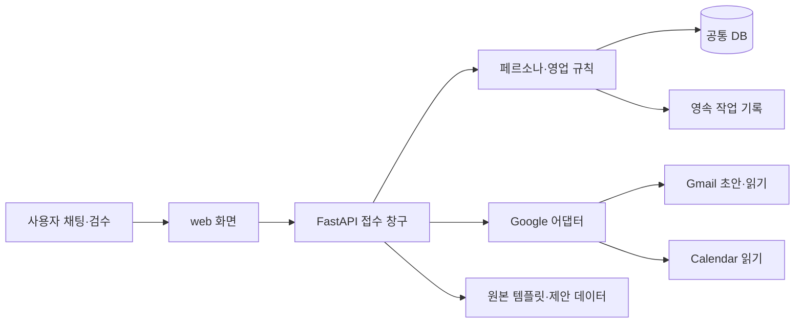

# 구조와 데이터 흐름

Sales AX는 화면·업무 규칙·외부 연결을 나눈 단일 Python 서비스다. 현재 기능의 최종 기준은 실제 등록된 API와 테스트이며, 개발 중 파일을 완료 기능으로 세지 않는다.

비유하면 `web/`는 주문 화면, API는 접수 창구, `service.py`는 직원이 지켜야 하는 업무 규칙, DB는 장부, jobs는 작업 대기표다. Google 어댑터는 외부 서비스 담당 창구다.

| 파일 | 수정하는 이유 |
|---|---|
| `web/index.html`, `web/style.css`, `web/app.js` | 화면 구조·디자인·화면에서 API를 부르는 동작 |
| `ax/api.py` | 기존 CRM·초안·미팅 API |
| `ax/persona.py` | 채팅 원문 → 편집 가능한 ICP 카드 → 승인된 캠페인 |
| `ax/jobs.py` | 작업 ID·멱등키·실패 상태를 DB에 보존 |
| `ax/service.py` | 동일인·수신거부·QA·승인·스레드·실제 미팅 완료 규칙 |
| `ax/integrations.py`, `ax/oauth.py` | 회사 Google 계정 연결과 상태 검사 |
| `ax/gmail.py`, `ax/google_readonly.py` | 외부 API 호출을 한곳으로 모아 교체 가능하게 함 |
| `ax/documents.py` | 수신자별 링크와 실제/가상 이벤트 구분 |
| `ax/db.py`, `ax/migrations.py` | 공통 테이블·추가 변경 이력 |
| `vendor/` | 원본 저장소와 회귀 테스트 보존 |

첫 버전은 단일 워크스페이스·단일 운영자다. 서버는 127.0.0.1만 수신한다. 외부에 공개할 때는 인증·HTTPS·운영 DB·파일 저장소·작업자를 별도로 준비한다. 누적 2만 연락처를 위해 고유키·관계·작업 경계를 먼저 유지하고, 검증 전에 마이크로서비스로 나누지 않는다.

AI 키가 없으면 페르소나 초안은 규칙 기반 수동 편집으로 명시한다. 이를 AI 연결 성공으로 표시하지 않는다. 외부 연결 없이도 고객·근거·검수 준비는 저장할 수 있다.
