# Sales AX — 현재 UI/UX 촬영 리뷰

촬영일: **2026-11-02, 약 03:26 KST**  
대상: **현재 실행 중인 로컬 웹서비스** `http://127.0.0.1:8765/`  
범위: **촬영·읽기 전용 분석만 수행. 기능·디자인·기존 데이터 변경 없음.**

## 1. 결과와 촬영 조건

- 현재 메뉴 8개를 데스크톱·모바일로 각각 촬영: **16장**.
- 실제 캠페인 생성 모달: 데스크톱·모바일 **2장**, 모바일 하단 확인 **1장** 추가.
- 합계 **19장**, 모두 `artifacts/screenshots/`에 저장.
- 브라우저 자동화: Codex in-app browser의 Playwright 인터페이스. 실제 페이지를 열고 각 화면 제목 표시, DOM 로딩, 폰트 로딩을 확인한 뒤 `fullPage: true`로 촬영.
- 데스크톱 뷰포트 **1440 × 900**, 모바일 뷰포트 **390 × 844**. 페이지 길이에 따라 이미지 높이는 뷰포트보다 길다.
- 브라우저의 세로 스크롤바가 15px을 차지하는 페이지는 전체 페이지 JPEG의 실제 콘텐츠 폭이 데스크톱 **1425px**, 모바일 **375px**이다. 뷰포트 설정은 요청한 1440/390을 유지했다. 원본 캡처는 늘이거나 잘라내거나 합성하지 않았다.
- 촬영용 뷰포트는 종료 후 기본값으로 복원했고 촬영 전용 탭은 닫았다.
- 개인정보 보호: 현재 로컬 고객 **0명**, 초안 **0개**. 실제 고객 데이터를 가져오거나 가짜 고객을 생성하지 않았다. 화면에 고객 개인정보·API 키·토큰은 없다. 기본 발신 주소 `marketing@creatobi.com`은 서비스에 이미 표시된 회사 발신 주소다.
- Gmail OAuth **미설정**, AI 어댑터 **미연결**, 실제 발송 **비활성화** 상태다. Calendar 연결 상태는 현재 화면에서 별도 확인할 수 없다.
- 촬영 중 브라우저가 수집한 `error`/`warn` 로그는 **0건**이었다. 기능 실행 테스트나 API 연동 성공을 뜻하지 않는다.

## 2. 요청한 6개 화면과 실제 구현 상태

| 요청 화면 | 현재 대응 화면 | 상태 | 촬영·검증 범위 |
|---|---|---|---|
| Dashboard — KPI·퍼널 | `/#dashboard` 대시보드 | **구현됨 · 빈 데이터** | KPI 카드, 고객 퍼널, 검토 항목, 최근 고객 빈 상태 촬영 |
| Lead Discovery — AI 고객 발굴 | `/#leads` 고객 발굴 | **부분 구현** | 수동 고객 추가·CSV 가져오기·고객 검색 진입 UI 존재. AI 후보 발굴 전용 화면·결과 큐는 **미구현** |
| CRM — 고객 목록·상세 | 고객 목록은 `/#leads`와 공유 | **목록 부분 구현 / 상세 미촬영** | 현재 목록은 0명. 고객 360° 상세 렌더링 코드는 있으나 실재 레코드가 없어 진입·촬영하지 않음. 상세 화면을 가짜 데이터로 만들지 않음 |
| Proposal Studio — 개인화 제안서 생성 | `/#templates` 템플릿 라이브러리 | **독립 생성 화면 미구현** | 원본 PPTX 등록 진입, 설득 단계 설명, 템플릿 빈 상태만 촬영. 개인화 생성·슬라이드 편집·PPTX/PDF 결과 화면 없음 |
| Email Workspace — Gmail 초안·발송 | `/#review` 제안·초안 검수함 | **부분 구현 · 빈 초안** | 초안 없음 안내와 고객 목록 이동 링크 촬영. 이메일 편집·고객 근거·PDF 3열 뷰 코드는 있으나 현재 데이터로는 표시되지 않음. 실제 Gmail 성공·발송 화면은 확인 불가 |
| Analytics — 열람·회신·미팅·전환율 | `/#analytics` 성과 분석 | **부분 구현** | 발송·회신·계약·매출 KPI, 사람 기준 퍼널 촬영. 문서 열람·페이지 체류·전환율 수치·세그먼트/기간 필터 화면은 **미구현** |

**미구현 화면에는 스크린샷을 만들지 않았다.** 대응하는 기존 화면을 참고 자료로 제공하되 완성된 기능 화면으로 분류하지 않았다.

그 밖에 실제 존재하는 `캠페인`, `회신·미팅`, `연동·실행 로그`도 모두 촬영했다.

## 3. 한눈에 비교

아래 이미지는 모두 실제 원본 캡처다. 클릭해 원본 크기로 확인할 수 있다. 모바일 이미지는 전체 페이지라 길다.

| 화면 | 데스크톱 | 모바일 |
|---|---|---|
| 01 Dashboard | [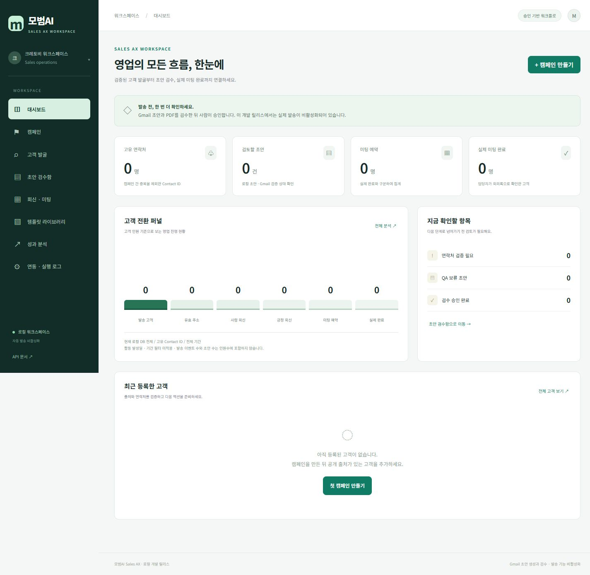](artifacts/screenshots/01-dashboard-desktop.jpg) | [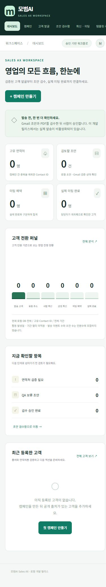](artifacts/screenshots/01-dashboard-mobile.jpg) |
| 02 Lead Discovery / CRM 목록 | [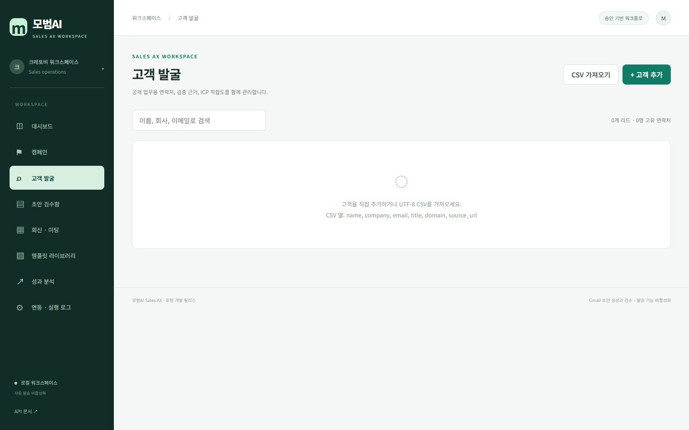](artifacts/screenshots/02-lead-discovery-crm-desktop.jpg) | [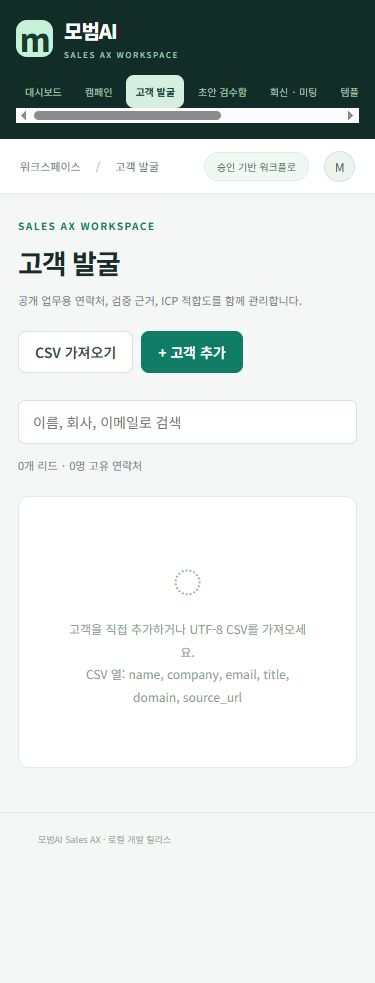](artifacts/screenshots/02-lead-discovery-crm-mobile.jpg) |
| 03 캠페인 | [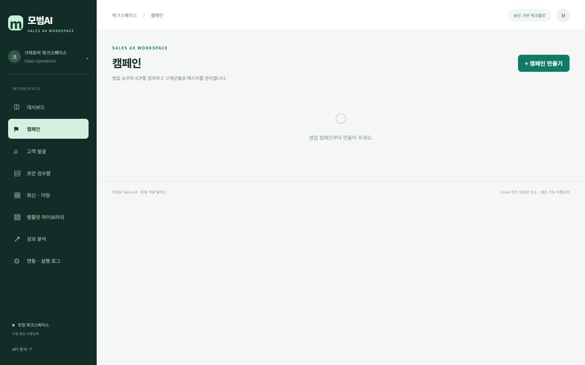](artifacts/screenshots/03-campaigns-desktop.jpg) | [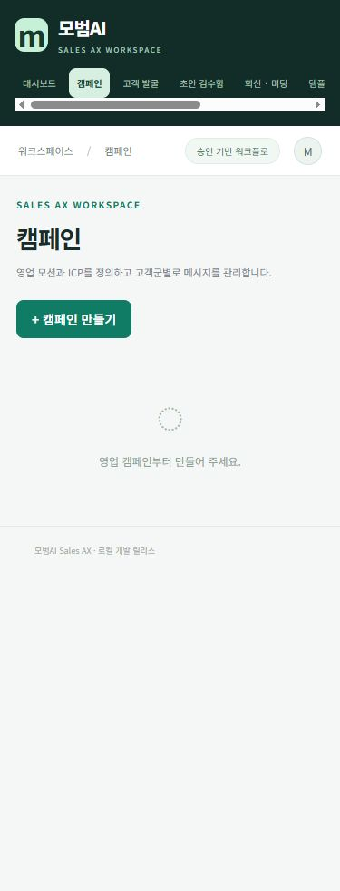](artifacts/screenshots/03-campaigns-mobile.jpg) |
| 04 Proposal 참고: 템플릿 라이브러리 | [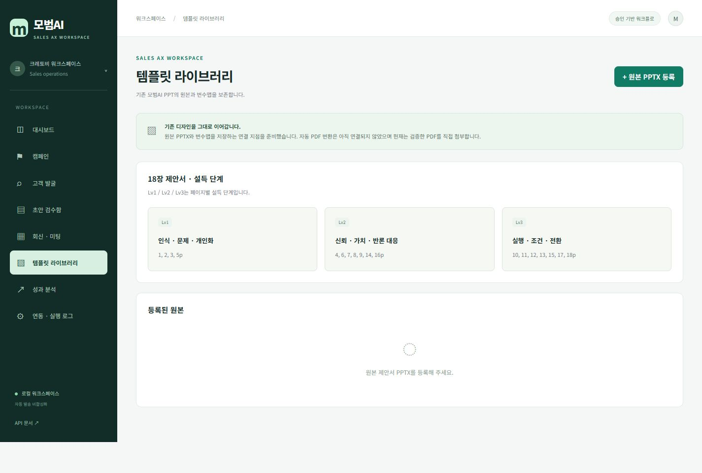](artifacts/screenshots/04-proposal-template-library-desktop.jpg) | [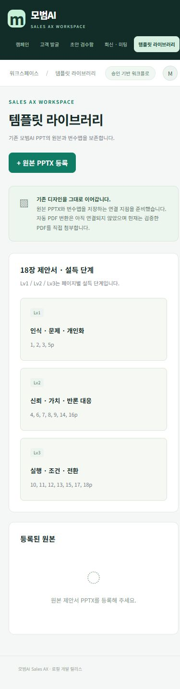](artifacts/screenshots/04-proposal-template-library-mobile.jpg) |
| 05 Email Workspace 빈 상태 | [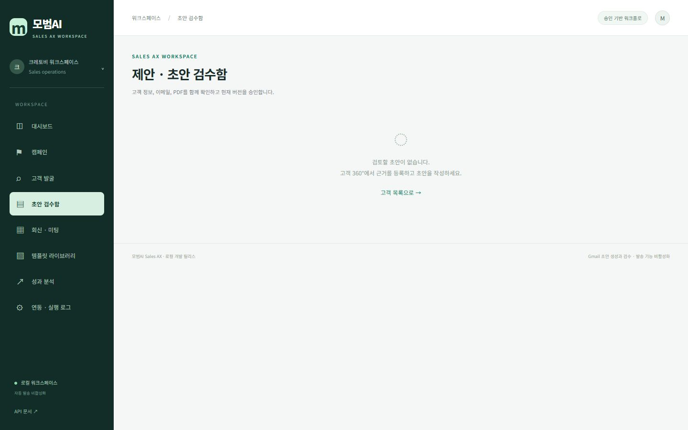](artifacts/screenshots/05-email-workspace-desktop.jpg) | [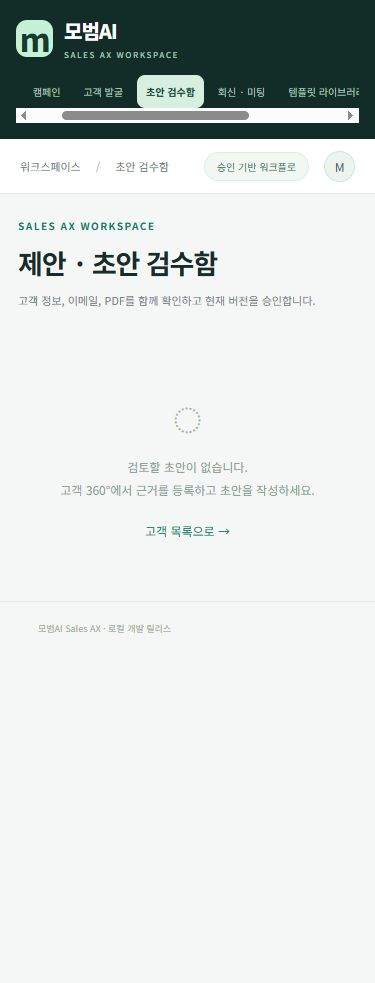](artifacts/screenshots/05-email-workspace-mobile.jpg) |
| 06 회신·미팅 | [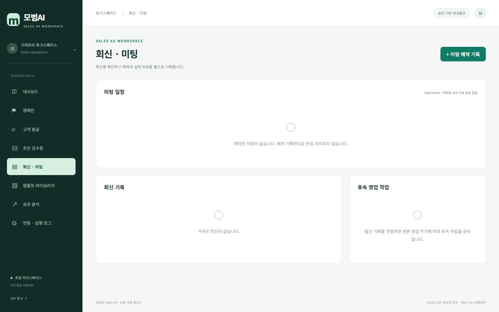](artifacts/screenshots/06-replies-meetings-desktop.jpg) | [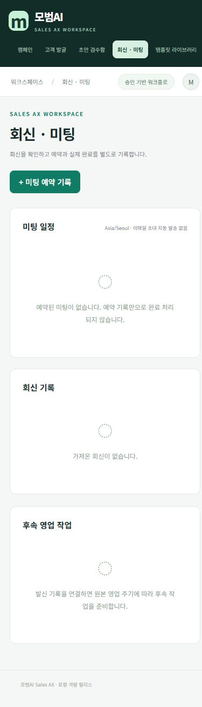](artifacts/screenshots/06-replies-meetings-mobile.jpg) |
| 07 Analytics | [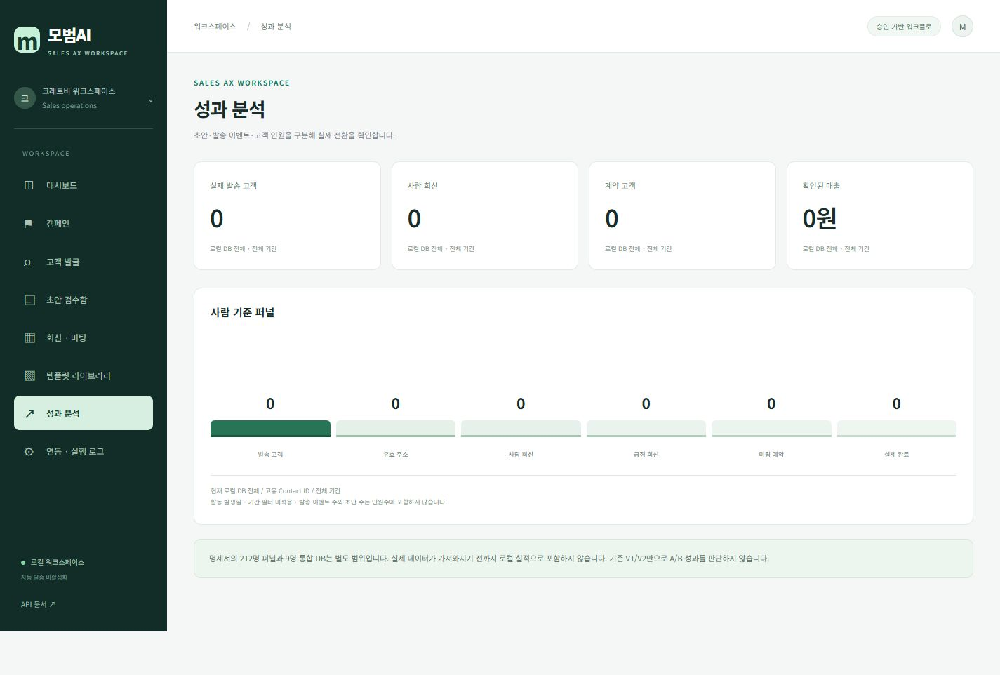](artifacts/screenshots/07-analytics-desktop.jpg) | [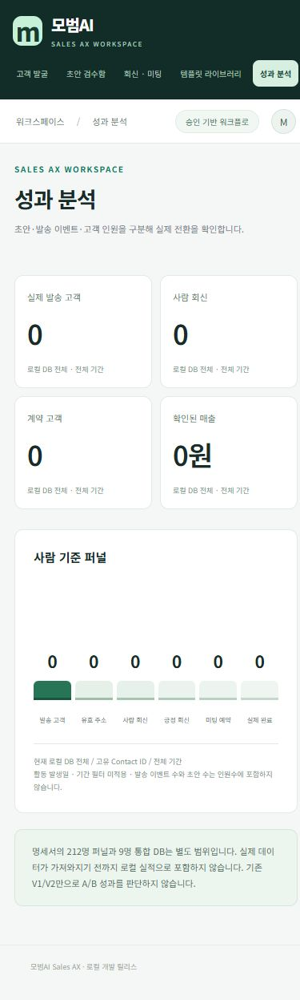](artifacts/screenshots/07-analytics-mobile.jpg) |
| 08 연동·실행 로그 | [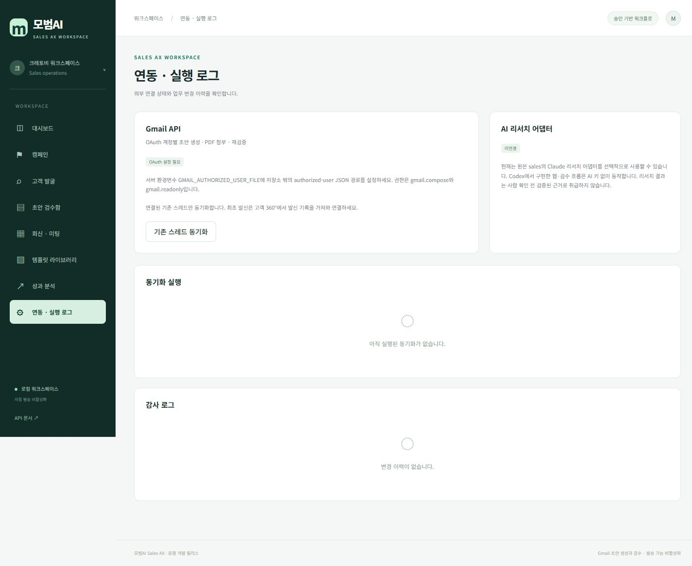](artifacts/screenshots/08-integrations-logs-desktop.jpg) | [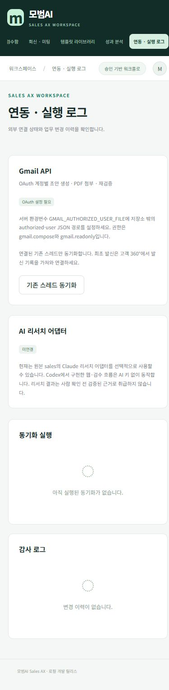](artifacts/screenshots/08-integrations-logs-mobile.jpg) |
| 09 실제 캠페인 생성 모달 | [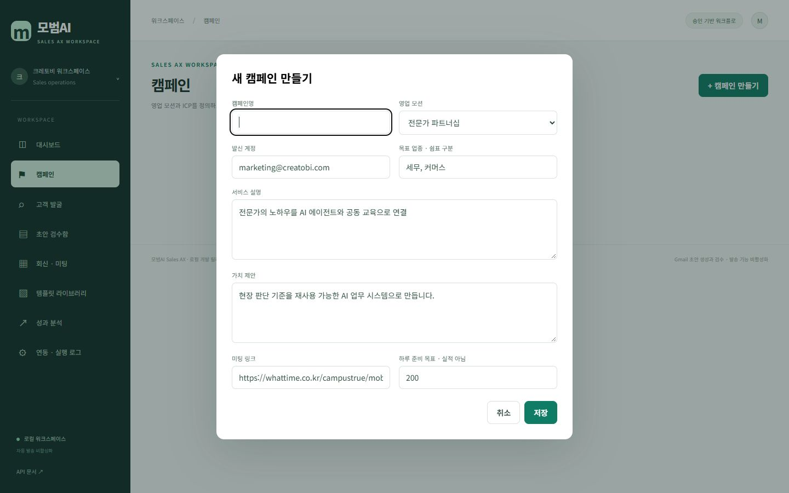](artifacts/screenshots/09-campaign-create-dialog-desktop.jpg) | [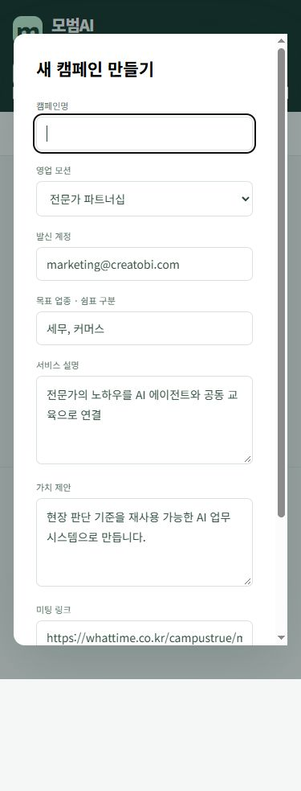](artifacts/screenshots/09-campaign-create-dialog-mobile.jpg) |

모바일 모달 하단: [추가 캡처](artifacts/screenshots/10-campaign-dialog-mobile-bottom.jpg). 저장 버튼을 누르지 않고 키보드 포커스만 이동해 하단을 확인했다.

## 4. UI/UX 문제점 — 관찰된 사실과 영향

| 우선순위 | 문제 | 근거 | 사용자 영향 / 후속 디자인 검토 방향 |
|---|---|---|---|
| 높음 | 핵심 영업 업무 흐름이 메뉴 사이에 분산됨 | 고객 발굴 → 고객 360° → 초안 검수 경로가 서로 다른 화면에 존재. 빈 초안 화면에는 목록 이동 링크만 있음 | 현재 어떤 준비가 부족한지, 다음으로 무엇을 해야 하는지 알기 어려움. 단계별 진척·다음 행동을 먼저 설계할 필요 |
| 높음 | 메뉴명과 실제 기능의 차이 | ‘고객 발굴’은 AI 후보 탐색 화면이 아니라 현재 CRM 목록·수동 입력 중심 | AI 탐색을 기대하고 진입한 사용자가 작업을 시작할 수 없음. Discovery와 CRM의 정보 구조 재검토 필요 |
| 높음 | 빈 상태에서 작업 영역을 파악하기 어려움 | 이메일 검수 화면에 제목·본문·첨부·QA 구조가 전혀 표시되지 않음. CRM도 컬럼 구조 없이 빈 카드만 표시 | 처음 사용하는 사람이 무엇을 준비해야 화면을 사용할 수 있는지 알기 어려움. 실데이터 없는 상태의 구조·필수 조건 안내가 필요하며 가짜 실적을 보여주면 안 됨 |
| 높음 | 읽기 어려운 작은 보조 글자 | 실제 계산 스타일: 본문 설명 11px, KPI 힌트·분모 9px, 모바일 퍼널 라벨 8px | KPI의 의미·범위·승인 조건을 읽기 어려움. 업무 정보의 크기와 위계 재설계 필요 |
| 높음 | 보조 글자 대비가 낮음 | 흰 배경 기준 KPI 힌트 `#81958a` 약 3.18:1, 분모 `#84958b` 약 3.16:1, 빈 상태 `#8b9c91` 약 2.89:1 | 작은 글자의 가독성이 낮음. 계산은 해당 CSS 전경과 흰 배경에 한정한 값이며 전체 접근성 인증은 아님 |
| 중간 | 0건 퍼널에도 막대가 표시됨 | Dashboard·Analytics의 모든 값이 0인데 같은 최소 높이의 색상 막대가 존재 | 데이터가 있는 것처럼 읽히거나 실제 비율로 오해할 수 있음. 0·unknown·미연결 상태의 시각 표현 구분 필요 |
| 중간 | 대시보드와 분석 화면의 구분이 약함 | 두 화면에 거의 같은 고객 퍼널이 반복됨 | 분석에서 추가로 얻는 정보가 적음. 개요와 진단·비교의 역할 구분 필요 |
| 중간 | 여백이 데이터보다 크게 강조됨 | 데스크톱 대시보드 전체 높이 1388px, 퍼널과 빈 고객 카드에 큰 빈 공간 | 한눈에 상태를 파악하기 어렵고 작업 밀도가 낮음. 빈 상태와 실데이터 상태 각각의 밀도 검토 필요 |
| 중간 | 빈 상태 아이콘이 로딩 표시처럼 보임 | 모든 빈 상태에 점선 원 `◌`가 반복됨 | 로딩 중인지 0건으로 확정된 상태인지 모호함. 로딩·빈 상태·연동 실패를 분리할 필요 |
| 중간 | 설정 화면에 구현 설명이 길게 노출됨 | OAuth 환경변수·JSON 경로·어댑터 설명이 주된 내용 | 실제 운영자에게 연결 방법·현재 계정·최근 성공 시각·문제 해결 경로가 잘 드러나지 않음 |
| 중간 | 연결 상태의 범위가 화면에 충분히 드러나지 않음 | Gmail·AI 상태는 있지만 Calendar·Sheets·문서 추적 제공자의 독립 상태가 없음 | 화면이 표시되는 것과 실제 연결 성공을 혼동할 수 있음. REAL/MANUAL/DEMO/BLOCKED와 확인 시각을 일관되게 설계할 필요 |
| 낮음 | 아이콘 언어가 일관되지 않음 | 여러 유니코드 기호를 혼합 사용 | 기능의 의미 전달이 약하고 플랫폼별 모양 차이가 생길 수 있음 |
| 낮음 | 푸터의 위치가 화면마다 크게 달라짐 | 빈 이메일 화면은 푸터가 화면 중간 이후에 있고 긴 대시보드는 맨 아래에 위치 | 화면 구조의 안정감이 떨어짐. 전체 레이아웃에서 여백·푸터 배치 규칙 검토 필요 |

위 항목은 **분석과 차후 검토 제안**이다. 이번 작업에서 수정하지 않았다.

## 5. 레이아웃·반응형 관찰

### 확인된 문제

1. **모바일 메뉴가 가로로 숨는다.** 메뉴 영역의 `clientWidth=343px`, `scrollWidth=564px`. 주요 항목이 화면 밖에 있지만 가로 이동 가능성을 알리는 단서가 약하다. 메뉴를 바꾸면 선택 항목을 따라 가로 위치가 달라져 첫 메뉴가 보이지 않는 경우도 있다.
2. **모바일 대시보드가 2057px로 길다.** 844px 화면 약 2.4개 분량이며, 빈 상태인데도 검토 항목·고객 등록 행동이 하단으로 밀린다.
3. **모바일 6단계 퍼널이 좁고 글자가 8px이다.** 가로 깨짐은 없지만 숫자·막대·라벨을 읽고 비교하기 어렵다. ‘넘치지 않음’이 곧 사용 가능함을 의미하지 않는다.
4. **모바일 캠페인 생성 모달은 내부 스크롤이 필요하다.** 첫 캡처에서 미팅 링크 이후 필드와 저장·취소가 보이지 않는다. 하단 추가 캡처에서 접근 가능한 것은 확인했으므로 버튼 자체의 누락은 아니다. 긴 모달과 페이지의 이중 스크롤, 하단 행동의 발견성이 문제다.
5. **빈 모바일 화면도 약 983px 길이다.** 모바일 상단 내비게이션과 `min-height:100vh` 본문 구조가 합쳐져, 데이터가 없는 화면에도 세로 스크롤이 생긴다.
6. **긴 데스크톱 전체 캡처에서 사이드바는 첫 900px까지만 이어진다.** 현재 고정형 사이드바가 뷰포트 높이를 따르기 때문이다. 전체 페이지 이미지에서 보이는 절단 형태이며, 사이드바 DOM이 사라진 오류로 단정하지 않는다.

### 확인되지 않은 문제

- 촬영한 8개 모바일 주 화면의 `main` 내부에는 뷰포트 밖으로 벗어난 요소가 감지되지 않았다. 페이지 전체의 수평 넘침도 없었다. 상단 메뉴 자체의 수평 스크롤은 위에서 별도 기록했다.
- 촬영한 화면에서 카드 겹침, 본문이 메뉴 아래로 들어가는 현상, 깨진 이미지, 빈 흰 화면은 발견하지 않았다.
- **데이터가 있는 CRM 테이블, 고객 상세, 이메일/PDF 3열 검수함, QA 오류·승인·실패 상태는 미검증**이다. 실제 레코드가 없는 상태에서 생성하지 않았으므로 반응형 품질을 보증할 수 없다.
- 실제 휴대폰·터치·소프트 키보드 테스트는 수행하지 않았다. 모바일 결과는 데스크톱 브라우저의 지정 뷰포트 캡처다.

## 6. 전체 스크린샷 경로와 실제 이미지 크기

프로젝트 루트 기준 상대 경로다. 모두 원본 JPEG 파일이다.

| 화면 | 데스크톱 경로 · 실제 픽셀 | 모바일 경로 · 실제 픽셀 |
|---|---|---|
| Dashboard | `artifacts/screenshots/01-dashboard-desktop.jpg` · 1425×1388 | `artifacts/screenshots/01-dashboard-mobile.jpg` · 375×2057 |
| Lead Discovery / CRM 목록 | `artifacts/screenshots/02-lead-discovery-crm-desktop.jpg` · 1440×900 | `artifacts/screenshots/02-lead-discovery-crm-mobile.jpg` · 375×983 |
| 캠페인 | `artifacts/screenshots/03-campaigns-desktop.jpg` · 1440×900 | `artifacts/screenshots/03-campaigns-mobile.jpg` · 375×983 |
| 템플릿 라이브러리 | `artifacts/screenshots/04-proposal-template-library-desktop.jpg` · 1425×963 | `artifacts/screenshots/04-proposal-template-library-mobile.jpg` · 375×1427 |
| Email Workspace | `artifacts/screenshots/05-email-workspace-desktop.jpg` · 1440×900 | `artifacts/screenshots/05-email-workspace-mobile.jpg` · 375×983 |
| 회신·미팅 | `artifacts/screenshots/06-replies-meetings-desktop.jpg` · 1440×900 | `artifacts/screenshots/06-replies-meetings-mobile.jpg` · 375×1310 |
| Analytics | `artifacts/screenshots/07-analytics-desktop.jpg` · 1425×962 | `artifacts/screenshots/07-analytics-mobile.jpg` · 375×1247 |
| 연동·실행 로그 | `artifacts/screenshots/08-integrations-logs-desktop.jpg` · 1425×1166 | `artifacts/screenshots/08-integrations-logs-mobile.jpg` · 375×1526 |
| 캠페인 생성 모달 | `artifacts/screenshots/09-campaign-create-dialog-desktop.jpg` · 1440×900 | `artifacts/screenshots/09-campaign-create-dialog-mobile.jpg` · 375×983 |
| 모바일 모달 하단 | 해당 없음 | `artifacts/screenshots/10-campaign-dialog-mobile-bottom.jpg` · 375×983 |

측정 자료: [`capture-manifest.json`](artifacts/screenshots/capture-manifest.json). 이 파일에는 뷰포트·페이지 크기·화면 텍스트·가로 넘침 관측 결과가 있다. 기본 8개 메뉴의 데스크톱·모바일 측정을 포함한다.

## 7. 프로젝트 구조와 실행 방법

```text
mobum-sales-ax/
  run.py                    FastAPI/Uvicorn 로컬 시작
  requirements.txt          Python 의존성
  ax/                       공통 DB·서비스·Gmail·API, 개발 중 모듈
  web/index.html            현재 웹 셸
  web/style.css             현재 스타일·반응형
  web/app.js                현재 화면·폼·내비게이션
  vendor/sales/             읽기 참조 원본
  vendor/saas/              읽기 참조 원본
  tests/                    기존 통합 테스트
  data/                     로컬 데이터; .gitignore 대상
  artifacts/screenshots/    이번 촬영 결과
  UI_REVIEW.md              이 문서
```

프로젝트 디렉터리에서 Python 환경에 의존성을 설치한 후 실행:

```powershell
python -m pip install -r requirements.txt
python run.py
```

이번 촬영 때는 이미 실행 중이던 서버의 `/api/status` 응답과 실제 웹 페이지를 확인하고 해당 프로세스를 그대로 사용했다. 별도 서버나 데모 화면을 만들지 않았고, 코드 재로딩·DB 가져오기·기능 변경도 수행하지 않았다.

이 작업 환경에는 일반 Python 명령이 설정되어 있지 않아, 기존 개발 때 준비한 작업용 Python으로 서버가 실행되어 있었다. 동일 작업 환경에서의 실행 명령은 작업공간 루트 기준 다음과 같다:

```powershell
& '.\work\runtime\python.exe' '.\outputs\mobum-sales-ax\run.py'
```

## 8. Claude Code 리디자인 인계 메모

- 이 문서는 현재 상태를 기록한 **리뷰 자료**다. 스크린샷의 빈 상태를 완성된 전체 기능 화면으로 해석하지 말 것.
- 우선 정보 구조를 검토할 대상: **고객 발굴 / CRM / 제안서 / 이메일 검수의 구분과 연결**, 다음 행동, 필수 준비 상태.
- 시각 검토 우선 대상: **작은 글자·낮은 대비**, 빈 공간, 0건 퍼널, 모바일 내비게이션, 긴 모달의 행동 버튼.
- 데이터가 있는 검수 화면·실제 고객 상세·PDF 콘텐츠는 이번 자료에 없다. 이를 설계하려면 이후 별도로 승인된 익명화 자료를 준비해야 한다. 이번 촬영에는 임의 샘플을 넣지 않았다.
- 승인과 발송의 구분, 예약과 실제 완료의 구분, 실제 데이터와 데모·미연결의 구분은 유지해야 한다.
- Gmail 비밀키나 고객 개인정보를 디자인 파일·스크린샷·샘플 코드에 넣지 말 것.

이번 촬영으로 생성한 결과물은 이 문서, 스크린샷, 촬영 메타데이터와 전달용 ZIP뿐이다. 기존 소스·기능·디자인·운영 데이터는 변경하지 않았다.
